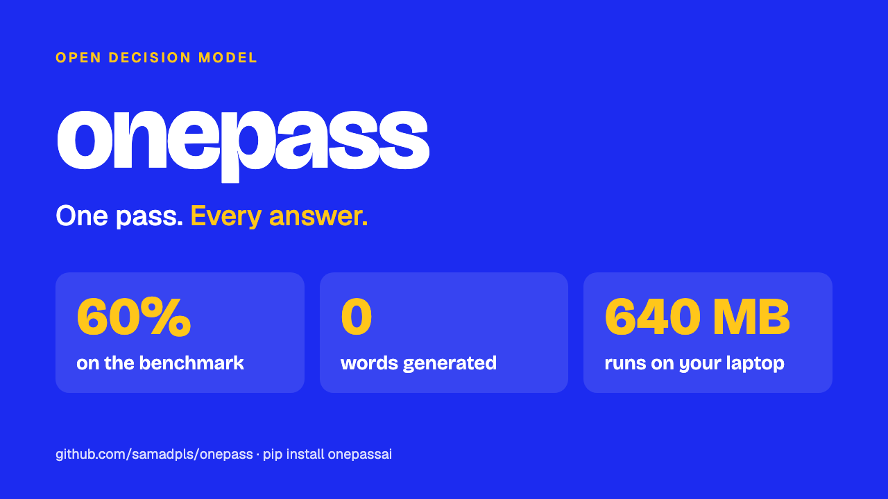
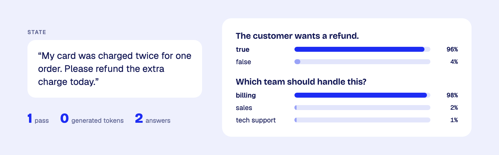

# onepass


A tiny open decision model. You give it a piece of text (the "state") and typed
questions: yes/no, choose one option, or pick a level on a scale. It returns a
probability for every possible answer, for all questions at once, from a single
forward pass. It generates no tokens, so the output can never be malformed.

The model is Qwen3-0.6B (or Qwen3-1.7B) with a LoRA adapter, trained on open
datasets. It was never trained on the benchmark it is scored on.

[](https://www.youtube.com/watch?v=ZZR8TRsX1h4)

**Watch the demo (90 seconds):** [youtube.com/watch?v=ZZR8TRsX1h4](https://www.youtube.com/watch?v=ZZR8TRsX1h4)

All models are in the [onepass collection](https://huggingface.co/collections/samadpls/onepass-6b06dee3eabd91e4de4df427) on Hugging Face:

| Size | transformers | GGUF (llama.cpp) | LoRA adapter |
|---|---|---|---|
| 0.6B | [onepass-qwen3-0.6b](https://huggingface.co/samadpls/onepass-qwen3-0.6b) | [onepass-qwen3-0.6b-GGUF](https://huggingface.co/samadpls/onepass-qwen3-0.6b-GGUF) | [onepass-qwen3-0.6b-lora](https://huggingface.co/samadpls/onepass-qwen3-0.6b-lora) |
| 1.7B | [onepass-qwen3-1.7b](https://huggingface.co/samadpls/onepass-qwen3-1.7b) | [onepass-qwen3-1.7b-GGUF](https://huggingface.co/samadpls/onepass-qwen3-1.7b-GGUF) | [onepass-qwen3-1.7b-lora](https://huggingface.co/samadpls/onepass-qwen3-1.7b-lora) |

## What it does



The probabilities above are the real output of the 8-bit 0.6B model for this message.
Every question gets a probability for each of its options, read from one forward pass.

## Results

Scored on the 400-case test split of
[LocalLLaMA/typed-decisions](https://huggingface.co/datasets/LocalLLaMA/typed-decisions)
(2,000 decisions), with the formulas from the benchmark's own scoring script.
Accuracy: higher is better. KL from gold, Brier and ECE: lower is better.

| Model | Accuracy | KL from gold | Brier | ECE |
|---|---|---|---|---|
| Qwen3-0.6B, no fine-tuning | 0.311 | 0.888 | 0.428 | 0.306 |
| Qwen3-1.7B, no fine-tuning | 0.278 | 1.914 | 0.812 | 0.611 |
| Label frequencies from the benchmark's train split (ignores the input) | 0.481 | 0.327 | 0.181 | **0.036** |
| **onepass 0.6B** | 0.601 | 0.270 | 0.154 | 0.049 |
| **onepass 1.7B** | **0.646** | **0.236** | **0.129** | 0.076 |

The 8-bit file (639 MB for the 0.6B) gives almost the same answers as the 16-bit one.
Results by question type, four held-out human-labelled sets, every file size, and what
happens when the model writes its answers instead: [docs/results.md](https://github.com/samadpls/onepass/blob/main/docs/results.md).

## How it got here

**Today** onepass 1.7B scores 0.646 on the benchmark's 400 test cases, and the 0.6B
scores 0.601. A baseline that ignores the input scores 0.481. The best small general
model on the leaderboard (under 1B, never trained on the benchmark) scored 0.531, by the
leaderboard's own number.

**My first full model lost to that baseline.** I trained it for about 5 hours on a
MacBook Pro (M3 Pro), on 16 human-labelled datasets. It scored 0.429.

**Even getting that far was slow.** The laptop ran out of memory because gradient
checkpointing was silently off: `from_pretrained` returns a model in eval mode. One
line, `model.train()`, fixed it. When the battery got low, macOS slowed the run about
four times. On Kaggle, asking for an L4 GPU silently gave me a CPU (PyTorch printed
`2.11.0+cpu`), and the free 2×T4 queue held my run for over 2 hours.

**I had trained it on the wrong kind of text.** The data was plain sentences: tweets,
reviews, questions about passages. The benchmark is business records written as JSON:
agent traces, invoices, security alerts, support threads.

**The benchmark ships its own training split:** 1,200 cases of exactly that kind. I did
not train on it, so the score stays honestly zero-shot.

**Instead I went looking.** I found about 20 public datasets in the same typed-question
format. I checked each one for its license, who made the labels, and overlap with the
benchmark: exact matches, any shared 10-word run, identical questions. Most were
dropped, for unclear licenses or for labels written by closed models whose terms may
forbid training on them. Three passed:
[n4ze3m/typed-decisions-synth](https://huggingface.co/datasets/n4ze3m/typed-decisions-synth) (MIT),
[decisionmodels/sn92-specialists](https://huggingface.co/datasets/decisionmodels/sn92-specialists) (CC BY 4.0) and
[tasksource/procedural-typed-decisions](https://huggingface.co/datasets/tasksource/procedural-typed-decisions) (Apache-2.0).
In generated data the right answer was listed first 51% of the time, so I shuffle the
options.

**Then I trained again** on Kaggle's two free T4 GPUs, with the human data plus those
three sets: 68,061 texts and 138,928 questions. The 0.6B took 4.5 hours and the 1.7B
took 8.8, side by side. They scored 0.601 and 0.646.

**It is not solved.** On SummEval, a held-out set about summary quality, training took
the 0.6B from 0.504 down to 0.265. It answers "good" almost every time where experts
said "excellent".

## Quick start

With [uv](https://docs.astral.sh/uv/) and nothing else installed, download the 8-bit
0.6B model and start the local server and demo page:

```bash
uvx --from huggingface_hub hf download samadpls/onepass-qwen3-0.6b-GGUF onepass-qwen3-0.6b-Q8_0.gguf --local-dir .
uvx --from "onepassai[serve]" onepass-serve onepass-qwen3-0.6b-Q8_0.gguf
```

Or run the web app from this repo:

```bash
uv run --extra serve --with streamlit --with huggingface_hub streamlit run demo/streamlit_app.py
```

The HTTP API, the Python API, the 1.7B model, and a copy-paste version that needs only
`transformers`: [docs/usage.md](https://github.com/samadpls/onepass/blob/main/docs/usage.md).

## How it works

1. **One slot per question.** The prompt lists the state, then each question with
   its options as letters (A, B, C ...), each followed by `Answer:`. The model's
   scores for the option letters at that position become the answer probabilities.
2. **No answer leaks into the next question.** A fixed placeholder follows every
   slot, so each answer depends only on the state and the questions so far.
3. **Trained on probabilities.** Where a dataset has several human raters, the
   training target is the share of raters who chose each answer, not a single label.
4. **One decode call at run time.** The whole prompt goes into one llama.cpp batch,
   with scores read only at the answer positions.

The data, how it was cleaned, and the training setup: [docs/training.md](https://github.com/samadpls/onepass/blob/main/docs/training.md).

## Docs

| Page | What's in it |
|---|---|
| [docs/results.md](https://github.com/samadpls/onepass/blob/main/docs/results.md) | Full benchmark results, held-out sets, GGUF sizes, generation baseline |
| [docs/usage.md](https://github.com/samadpls/onepass/blob/main/docs/usage.md) | Server, HTTP API, Python, demo app, using it with only `transformers` |
| [docs/training.md](https://github.com/samadpls/onepass/blob/main/docs/training.md) | Prompt layout, data sources, cleaning, LoRA training, calibration |

## Credit

Built by Abdul Samad ([samadpls.com](https://samadpls.com), abdulsamadsid1@gmail.com).
Licensed under Apache-2.0.
