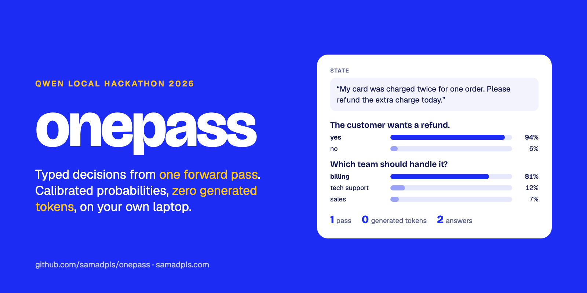

# onepass



A tiny open decision model. You give it a piece of text (the "state") and typed
questions: yes/no, choose one option, or pick a level on a scale. It returns a
probability for every possible answer, for all questions at once, from a single
forward pass. It generates no tokens, so the output can never be malformed.

The model is Qwen3-0.6B (or Qwen3-1.7B) with a LoRA adapter, trained on open
datasets. It was never trained on the benchmark it is scored on.

All models are in the [onepass collection](https://huggingface.co/collections/samadpls/onepass-6b06dee3eabd91e4de4df427) on Hugging Face:

| Size | transformers | GGUF (llama.cpp) | LoRA adapter |
|---|---|---|---|
| 0.6B | [onepass-qwen3-0.6b](https://huggingface.co/samadpls/onepass-qwen3-0.6b) | [onepass-qwen3-0.6b-GGUF](https://huggingface.co/samadpls/onepass-qwen3-0.6b-GGUF) | [onepass-qwen3-0.6b-lora](https://huggingface.co/samadpls/onepass-qwen3-0.6b-lora) |
| 1.7B | [onepass-qwen3-1.7b](https://huggingface.co/samadpls/onepass-qwen3-1.7b) | [onepass-qwen3-1.7b-GGUF](https://huggingface.co/samadpls/onepass-qwen3-1.7b-GGUF) | [onepass-qwen3-1.7b-lora](https://huggingface.co/samadpls/onepass-qwen3-1.7b-lora) |

## What it does


The probabilities above are the real output of the 8-bit 0.6B model for this message.
Every question gets a probability for each of its options, read from one forward pass.

## Results

Scored on the 400-case test split of
[LocalLLaMA/typed-decisions](https://huggingface.co/datasets/LocalLLaMA/typed-decisions)
(2,000 decisions), with the formulas from the benchmark's own scoring script.
Accuracy: higher is better. KL from gold, Brier and ECE: lower is better.

| Model | Accuracy | KL from gold | Brier | ECE |
|---|---|---|---|---|
| Qwen3-0.6B, no fine-tuning | 0.311 | 0.888 | 0.428 | 0.306 |
| Qwen3-1.7B, no fine-tuning | 0.278 | 1.914 | 0.812 | 0.611 |
| Label frequencies from the benchmark's train split (ignores the input) | 0.481 | 0.327 | 0.181 | **0.036** |
| **onepass 0.6B** | 0.601 | 0.270 | 0.154 | 0.049 |
| **onepass 1.7B** | **0.646** | **0.236** | **0.129** | 0.076 |

The 8-bit file (639 MB for the 0.6B) gives almost the same answers as the 16-bit one.
Results by question type, four held-out human-labelled sets, every file size, and what
happens when the model writes its answers instead: [docs/results.md](docs/results.md).

## Quick start

With [uv](https://docs.astral.sh/uv/) and nothing else installed, download the 8-bit
0.6B model and start the local server and demo page:

```bash
uvx --from huggingface_hub hf download samadpls/onepass-qwen3-0.6b-GGUF onepass-qwen3-0.6b-Q8_0.gguf --local-dir .
uvx --from "onepass[serve] @ git+https://github.com/samadpls/onepass" onepass-serve onepass-qwen3-0.6b-Q8_0.gguf
```

Or run the web app from this repo:

```bash
uv run --extra serve --with streamlit --with huggingface_hub streamlit run demo/streamlit_app.py
```

The HTTP API, the Python API, the 1.7B model, and a copy-paste version that needs only
`transformers`: [docs/usage.md](docs/usage.md).

## How it works

1. **One slot per question.** The prompt lists the state, then each question with
   its options as letters (A, B, C ...), each followed by `Answer:`. The model's
   scores for the option letters at that position become the answer probabilities.
2. **No answer leaks into the next question.** A fixed placeholder follows every
   slot, so each answer depends only on the state and the questions so far.
3. **Trained on probabilities.** Where a dataset has several human raters, the
   training target is the share of raters who chose each answer, not a single label.
4. **One decode call at run time.** The whole prompt goes into one llama.cpp batch,
   with scores read only at the answer positions.

The data, how it was cleaned, and the training setup: [docs/training.md](docs/training.md).

## Docs

| Page | What's in it |
|---|---|
| [docs/results.md](docs/results.md) | Full benchmark results, held-out sets, GGUF sizes, generation baseline |
| [docs/usage.md](docs/usage.md) | Server, HTTP API, Python, demo app, using it with only `transformers` |
| [docs/training.md](docs/training.md) | Prompt layout, data sources, cleaning, LoRA training, calibration |

## Credit

Built by Abdul Samad ([samadpls.com](https://samadpls.com), abdulsamadsid1@gmail.com).
Licensed under Apache-2.0.
